# NeonOrder

Minecraft order plugin for creating, fulfilling, and managing player orders.

## Workflow

1. Player creates an order.
2. Order is stored in the database.
3. Another player fulfills it.
4. Items and payment are settled.

## Getting started

Build with `./gradlew build` and install the JAR on a compatible Paper server.

## License

This repository includes contributions from other authors and remains under [Apache-2.0](LICENSE).
